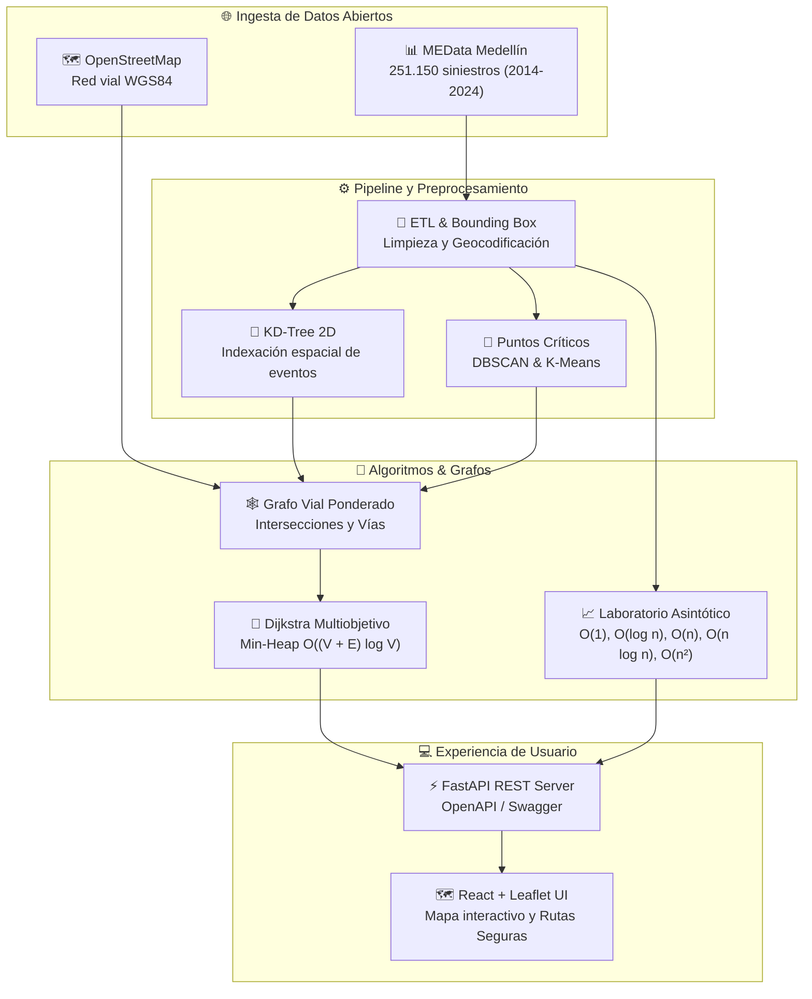

# 🏠 AburráSegura — Plataforma de Enrutamiento Seguro y Analítica Vial

> [!abstract] En pocas palabras
> AburráSegura es una plataforma de analítica geoespacial y enrutamiento inteligente diseñada para la ciudad de Medellín. Permite a ciudadanos, ciclistas y conductores calcular rutas óptimas seguras que evitan zonas con alta concentración de siniestros viales (puntos críticos), combinando algoritmos de grafos sobre la red vial de OpenStreetMap y el histórico oficial de más de 250.000 siniestros del portal MEData.

| 📌 Estado | 👤 Autores / Responsables | 🗓️ Actualizado | 🏛️ Institución / Contexto |
|---|---|---|---|
| **Consolidado Fase Final (v2.1)** | Sebastián Gómez, Jarrison Quintero, Cristian Pulgarín | 2026-10-19 | **Tecnológico de Antioquia** · PPI Análisis de Algoritmos (8vo Semestre) |

---

## 🧭 ¿Por dónde empiezo? (Rutas de lectura según tu rol)

| Si eres… | Lee primero | Luego profundiza en |
|---|---|---|
| 🎓 **Tribunal o Docente Evaluador** | [[MOC-Principal]] | [[Matriz-Requisitos]] · [[Conclusiones-y-Resultados]] |
| 🔬 **Investigador / Marco Teórico** | [[Antecedentes-Academicos]] | [[Fuentes-y-Matriz-Decision]] · [[Referencias-APA7]] |
| 📊 **Científico o Ingeniero de Datos** | [[Diccionario-Variables]] | [[Pipeline-Limpieza]] · [[Clustering-DBSCAN-KMeans]] |
| 🧠 **Especialista en Algoritmos** | [[Grafos-Dijkstra-AStar]] | [[Laboratorio-Jerarquia-Asintotica]] · [[Estructuras-Espaciales-KDTree]] |
| 🏗️ **Arquitecto o Dev Backend** | [[ADR-002-Arquitectura-FastAPI-React]] | [[Diseno-Backend-API]] · [[ADR-005-Replanteamiento-Alcance-Dijkstra-Puntos-Criticos-y-Laboratorio-Complejidad]] |
| 🎨 **Desarrollador Frontend / UI** | [[Diseno-Frontend-UI]] | [[Manual-Usuario-Prototipo]] |
| 🧪 **Ingeniero de Calidad (QA)** | [[Plan-Pruebas-QA]] | [[Reporte-Final-QA-Fase5]] (44/44 tests aprobados) |
| 🗣️ **Preparación de Sustentación** | [[Guion-Sustentacion-Oral]] | [[Hoja-de-Ruta-Nuevo-Horizonte]] |

---

## 🗺️ El Proyecto de un Vistazo

Vista general navegable e interactiva: ![[Mapa del proyecto.canvas]]

---

## 📚 Estructura General del Vault

El conocimiento de AburráSegura está categorizado en 10 módulos interconectados mediante wikilinks y soporte matemático KaTeX:

- **[[00-Inicio/MOC-Principal|00 · Inicio y Gestión Estratégica]]**: Ficha técnica oficial, MOC principal y hoja de ruta.
- **[[01-Documento-guia-y-requisitos/Matriz-Requisitos|01 · Documento Guía y Requisitos]]**: Trazabilidad R1–R10, RF-01 a RF-16 y restricciones normativas/hardware.
- **[[02-Investigacion/Antecedentes-Academicos|02 · Investigación y Marco Teórico]]**: Estado del arte, Cormen, Dijkstra, Bentley, fuentes MEData vs SODA vs OSM y referencias APA 7.
- **[[03-Datos/Diccionario-Variables|03 · Datos de Siniestralidad Vial]]**: Diccionario de variables, control de sesgos históricos y pipeline ETL SQLite/CSV.
- **[[04-Algoritmos/Grafos-Dijkstra-AStar|04 · Algoritmos y Complejidad]]**: Modelado formal, demostraciones de cotas $\mathcal{O}, \Omega, \Theta$, KD-Tree, Dijkstra con Min-Heap, ordenamiento y Laboratorio de Complejidad.
- **[[05-Arquitectura-y-ADRs/ADR-001-Enfoque-Siniestros-y-Grafo-OSM|05 · Arquitectura y Decisiones (ADRs)]]**: Decisiones arquitectónicas registradas (ADR-001 a ADR-005).
- **[[06-Backend-API/Diseno-Backend-API|06 · Backend & API REST]]**: Arquitectura FastAPI, servicios modulares, inyección de dependencias y contratos OpenAPI.
- **[[07-Frontend/Diseno-Frontend-UI|07 · Frontend Web]]**: Interfaz React + Vite, mapa de calor Leaflet, selector de perfiles de riesgo y panel asintótico.
- **[[08-QA/Plan-Pruebas-QA|08 · Aseguramiento de Calidad (QA)]]**: Plan de pruebas, suite de 44 tests automatizados (100% PASS en 8.31s) y cobertura.
- **[[09-Resultados-y-conclusiones/Conclusiones-y-Resultados|09 · Resultados y Conclusiones]]**: Métricas de mitigación de riesgo, validación de hipótesis, manual de usuario y guion de sustentación.
- **[[01-Documento-guia-y-requisitos/Registro-Actualizaciones|Historial de Cambios y Versiones]]**: Registro de versiones v1.0 a v2.1 y sincronización con `AburráSegura.docx`.

---

## 🔔 Novedades Recientes

- **2026-10-19** — Estandarización del vault bajo las directrices del plugin `obsidian-docs` (integración de `00 - Inicio.md`, Canvas navegable y metadatos unificados).
- **2026-10-08** — Sincronización final contra `AburráSegura.docx` (v2.1). Certificación de 44/44 pruebas aprobadas en Pytest.
- **2026-10-07** — Implementación del **Laboratorio de Jerarquía Asintótica** en tiempo real para contrastar curvas empíricas vs. teóricas ($\mathcal{O}(1)$ a $\mathcal{O}(n^2)$) sobre 251.150 siniestros reales.

---

## 🔗 Relacionado

- [[MOC-Principal|MOC Principal de AburráSegura]]
- [[Hoja-de-Ruta-Nuevo-Horizonte|Hoja de Ruta del Proyecto]]
- [[Matriz-Requisitos|Matriz Integral de Trazabilidad]]
- [[Registro-Actualizaciones|Registro Formal de Actualizaciones]]
- [[Mapa del proyecto.canvas|Canvas Interactivo del Sistema]]
