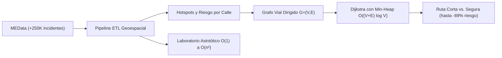

# Hoja de Ruta — Horizonte Consolidado del Proyecto AburráSegura

> [!abstract] En pocas palabras
> Plan de trabajo y cronograma estratégico consolidado tras el replanteamiento pedagógico, priorizando el enrutamiento seguro sobre grafos con Dijkstra y el Laboratorio de Complejidad.

## 1. Definición del Proyecto en una Frase
Una plataforma computacional integral que identifica los **puntos críticos de siniestralidad vial en Medellín** a partir de 251.150 incidentes abiertos de MEData, calcula la **Ruta Más Corta vs. Ruta Más Segura mediante el Algoritmo de Dijkstra con cola de prioridad *min-heap*** y una función multiobjetivo de aversión al riesgo, y dispone de un **Laboratorio de Rendimiento** que evalúa en tiempo real las 5 clases fundamentales de la jerarquía asintótica ($\mathcal{O}(1), \mathcal{O}(\log n), \mathcal{O}(n), \mathcal{O}(n \log n), \mathcal{O}(n^2)$) sobre esos mismos datos territoriales.

---

## 2. Estado de Cumplimiento en el Documento Oficial (`AburráSegura.docx`)

| Bloque / Sección del Informe | Contenido Formal | Estado en `AburráSegura.docx` |
| :--- | :--- | :---: |
| **Preliminares y Portada** | Título institucional, autores oficiales (Jarrison, Sebastián, Cristian David) y Medellín 2026. | ✅ **100% Incorporado** |
| **Tabla 0: Control de Versiones** | Registro histórico desde v1.0 (07/09) hasta v2.1 (08/10). | ✅ **100% Incorporado** |
| **Tabla 1: Abreviaturas Técnicas** | **25 siglas ordenadas alfabéticamente** con definiciones completas (API, B-Tree, CORS... WGS84). | ✅ **100% Incorporado** |
| **Resumen e Introducción** | Resumen (máx 300 palabras), problemática del Valle de Aburrá, crítica a Waze/Google Maps. | ✅ **100% Incorporado** |
| **Sección 1: Planteamiento** | Problema, justificación académica/social, objetivos (Tabla 2 con fases/entregables) y alcances. | ✅ **100% Incorporado** |
| **Sección 2: Marco Teórico** | Antecedentes (Tabla 3), analogía de control, comunicaciones móviles (4G/Wi-Fi) y arquitectura de hardware. | ✅ **100% Incorporado** |
| **Sección 3: Requerimientos** | **16 Requerimientos Funcionales (RF-01 a RF-16)** en Tablas 4 a 8 y Restricciones de Diseño (Tablas 9 a 13). | ✅ **100% Incorporado** |
| **Sección 4.1: Componentes / Costos** | Selección de componentes y presupuesto referencial en Tabla 14 ($3.940.000 COP con equipos propios). | ✅ **100% Incorporado** |
| **Sección 4.2: Diseño del Software** | Arquitectura en 3 capas, modelado de red vial, función de coste ponderada, Dijkstra y flujo (Figuras 1 y 2). | ✅ **100% Incorporado** |
| **Sección 4.3: Diseño de Interfaz** | Mockup 1 (Búsqueda), Mockup 2 (Rutas azul vs. verde), Mockup 4 (Mapa de puntos críticos y halos). | ✅ **100% Incorporado** |
| **Sección 6: Referencias APA 7** | 11 referencias bibliográficas estandarizadas bajo normas APA 7ma edición alfabéticamente. | ✅ **100% Incorporado** |
| **Sección 5: Implementación** | Evidencias operativas del prototipo, certificación de **44/44 pruebas Pytest** y tablas asintóticas. | 🟡 **Listo en Vault ([[Reporte-Final-QA-Fase5]])** |
| **Sección 6: Conclusiones** | Evaluación formal de cumplimiento por objetivo (100%), aprendizajes teóricos/empíricos e impacto. | 🟡 **Listo en Vault ([[Conclusiones-y-Resultados]])** |
| **Sección 7: Anexos** | Manual de usuario del software y especificación técnica de la API. | 🟡 **Listo en Vault ([[Manual-Usuario-Prototipo]])** |

---

## 3. Estado de Certificación Técnica del Software
- **Suite de Pruebas Automatizadas:** **44 de 44 pruebas superadas con éxito (100% PASS)** en `8.31 segundos` bajo Pytest 9.1.1 y Python 3.14.3.
- **Frontend Web SPA:** Empaquetado de producción de React 18 + Vite generado limpiamente en `frontend/dist/`.
- **Base de Datos Local:** SQLite indexado con 251.150 incidentes limpios de Medellín y tiempo de consulta sub-milisegundo.
- **Servidor Backend:** FastAPI operativo en el puerto 8000 con contratos OpenAPI 3.1 interactivos en Swagger (`/docs`).

---

## 🔗 Relacionado
- [[00 - Inicio|Inicio]]
- [[MOC-Principal]]
- [[Archivo-Alcance-Anterior]]
- [[ADR-005-Replanteamiento-Alcance-Dijkstra-Puntos-Criticos-y-Laboratorio-Complejidad|ADR-005]]
