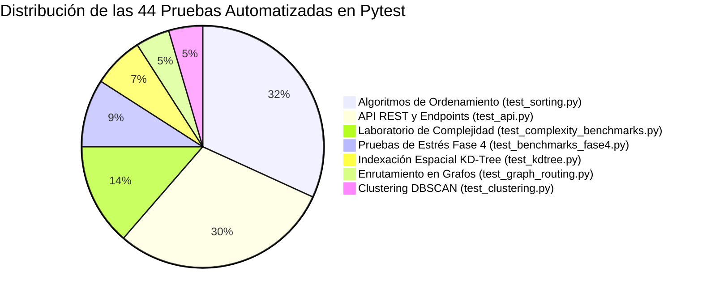

# Matriz Integral de Requisitos y Trazabilidad (v4.1 — Definitiva)

> [!abstract] En pocas palabras
> Matriz integral de trazabilidad que conecta los requisitos institucionales (R1 a R10) y 16 requerimientos funcionales con el código fuente y las 44 pruebas Pytest.

Esta matriz integra la **trazabilidad institucional del PPI (R1 a R10)** con los **16 Requerimientos Funcionales (RF-01 a RF-16)** y las **Restricciones de Diseño** estipulados formalmente en `AburráSegura.docx` (Sección 3), relacionándolos directamente con el código fuente y las **44 pruebas automatizadas en Pytest**.

---

## 1. Alineación con los Objetivos Específicos del PPI (Tabla 2 de `AburráSegura.docx`)

| N° | Objetivo Específico | Fase / Entregable Asociado en Documento | Requisitos Clave |
| :-: | :--- | :--- | :---: |
| **1** | **Adquirir, limpiar y estructurar** los datos abiertos de siniestros viales de Medellín para delimitar y ponderar las zonas con mayor concentración histórica de accidentes. | **Fase 1: Análisis y Procesamiento de Datos** • Pipeline ETL geoespacial de 251.150 siniestros MEData con validación WGS84. • Base de datos relacional SQLite indexada (`medellin_incidents.db`). • Matriz de delimitación de puntos críticos viales (*hotspots*) y cuadrícula analítica de riesgo. | R2, R3 (RF-01 a RF-05) |
| **2** | **Modelar la red vial como un grafo ponderado** e implementar el algoritmo de Dijkstra con una función de coste multiobjetivo que equilibre la distancia geométrica y la penalización por zonas de riesgo. | **Fase 2: Diseño e Implementación Algorítmica** • Modelo topológico de la red vial en grafo dirigido ponderado $G = (V, E)$ (`medellin_graph.json`). • Algoritmo de Dijkstra con cola de prioridad *min-heap* ($\mathcal{O}((V + E) \log V)$) y función de coste multiobjetivo con aversión al riesgo. • API REST en FastAPI (`/api/v1/routing/calculate`) con trazado continuo. | R4, R5 (RF-06 a RF-11) |
| **3** | **Evaluar empíricamente el tiempo de ejecución y la complejidad asintótica** del algoritmo frente al tamaño de la red vial, comparando la ruta más corta frente a la ruta más segura en términos de distancia y siniestralidad evitada. | **Fase 3: Pruebas, Benchmarking e Integración** • Laboratorio de benchmarking asintótico en tiempo real ($\mathcal{O}(1)$ a $\mathcal{O}(n^2)$) sobre MEData (`/api/v1/benchmarks/complexity`). • Suite automatizada de 44 pruebas unitarias y de integración en Pytest. • Aplicación web interactiva SPA (React 18 + Leaflet) con cálculo comparativo de rutas y panel de métricas. | R6, R7, R8, R9 (RF-12 a RF-16) |

---

## 2. Requerimientos Institucionales PPI (R1 a R10)

| ID | Requisito Macro | Obj. | Responsable | Entregable Técnico / Documental | Verificación y Pruebas | Estado Documento | Estado Código |
| :--- | :--- | :---: | :--- | :--- | :--- | :---: | :---: |
| **R1** | **Gestión Documental Institucional** | — | Documentador | `AburráSegura.docx` (v2.1) + Vault Obsidian sincronizado | Inspección contra formato guía TdeA | ✅ Al día | — |
| **R2** | **Ingesta y Limpieza Geoespacial** | 1 | Analista de Datos | `scripts/clean_and_preprocess.py`, `data/processed/medellin_incidents.db` | Bounding Box $[6.15, 6.38] \text{ Lat}, [-75.70, -75.45] \text{ Lon}$; 251.150 registros | ✅ Sec. 1.4 / 5.1 | ✅ Operativo |
| **R3** | **Delimitación de Puntos Críticos** | 1 | Analista + Algoritmos | Endpoint `/api/v1/incidents/hotspots` y asignación de severidad | Agrupamiento por tramo y validación visual con sectores históricos | ✅ Sec. 3.1 / 4.2 | ✅ Operativo |
| **R4** | **Modelado Topológico de Red Vial** | 2 | Especialista Algoritmos | `data/processed/medellin_graph.json` (32 nodos arteriales, 84 aristas dirigidas) | Conectividad de componentes y no negatividad de distancias Haversine | ✅ Sec. 4.2 | ✅ Operativo |
| **R5** | **Algoritmo de Dijkstra Multiobjetivo** | 2 | Especialista Algoritmos | `app/algorithms/graph_routing.py` (Dijkstra puro con *min-heap*) | `tests/test_graph_routing.py` (2 tests), `tests/test_api.py` | ✅ Sec. 1.2 / 4.2 | ✅ Operativo |
| **R6** | **Laboratorio de Jerarquía Asintótica** | 3 | Especialista + QA | `app/algorithms/complexity_benchmarks.py` ($\mathcal{O}(1), \mathcal{O}(\log n), \mathcal{O}(n), \mathcal{O}(n \log n), \mathcal{O}(n^2)$) | `tests/test_complexity_benchmarks.py` (6 tests) | ✅ Sec. 2.2 / 4.2 | ✅ Operativo |
| **R7** | **Evaluación Empírica y Benchmarking** | 3 | QA Tester | Tablas de escalamiento temporal ($n=1\text{K}$ a $1\text{M}$), constantes ocultas | `tests/test_benchmarks_fase4.py` (4 tests) | ✅ Sec. 4.2 / 5.1 | ✅ Operativo |
| **R8** | **Interfaz Web Interactiva (SPA)** | — | Frontend Dev | `frontend/src/` (React 18 + Vite + Leaflet: MapView, AlgorithmLab, Dashboard) | Flujo completo de consulta y visualización de rutas azul vs. verde | ✅ Sec. 4.3 | ✅ Operativo |
| **R9** | **Aseguramiento de Calidad (QA)** | — | QA Tester | Suite de 44 pruebas automatizadas en Pytest (100% aprobadas) | `python -m pytest` (44 passed en 8.31s) | ✅ Sec. 5.1 / 6 | ✅ Operativo |
| **R10**| **Conclusiones, Impacto y Manual** | Todos| Documentador | Secciones 6 y 7 de `AburráSegura.docx` y notas en Obsidian | Evaluación por objetivo, lecciones teóricas/empíricas y manual de usuario | ✅ Sec. 6 y 7 | ✅ Operativo |

---

## 3. Catálogo Detallado de Requerimientos Funcionales (RF-01 a RF-16)

Especificados en las **Tablas 4 a 8 de `AburráSegura.docx` (Sección 3.1)**:

### Módulo A: Datos de Siniestralidad Vial (Tabla 4)
| Código | Requerimiento | Descripción Formal | Prioridad | Obj. | Archivo de Código | Prueba Pytest |
| :--- | :--- | :--- | :---: | :---: | :--- | :--- |
| **RF-01** | **Cargar datos de siniestros** | Cargar el conjunto de datos histórico de siniestros viales abiertos de Medellín (MEData). | Alta | 1 | `app/services/data_service.py` | `test_incidents_list` |
| **RF-02** | **Depurar los datos** | Descartar registros duplicados, sin coordenadas o fuera del área urbana de Medellín ($[6.15, 6.38], [-75.70, -75.45]$). | Alta | 1 | `scripts/clean_and_preprocess.py` | `test_incidents_list` |
| **RF-03** | **Filtrar datos por variables** | Filtrar los datos por año ($2014\dots2024$), nivel de gravedad (`SOLO DAÑOS`, `CON HERIDOS`, `CON MUERTOS`) o comuna. | Media | 1 | `app/api/v1/incidents.py` | `test_incidents_filter_gravedad` |

### Módulo B: Análisis Espacial y Red Vial (Tabla 5)
| Código | Requerimiento | Descripción Formal | Prioridad | Obj. | Archivo de Código | Prueba Pytest |
| :--- | :--- | :--- | :---: | :--- :--- | :--- |
| **RF-04** | **Identificar puntos críticos** | Identificar las zonas de la ciudad con mayor concentración histórica de accidentes (*hotspots* como Glorieta de la 33, Punto Cero). | Alta | 1 | `app/api/v1/incidents.py` | `test_incidents_hotspots` |
| **RF-05** | **Asignar nivel de riesgo a las vías** | Asignar a cada tramo vial un nivel de riesgo según la cantidad y gravedad de accidentes ocurridos en él. | Alta | 1 | `app/algorithms/graph_routing.py` | `test_graph_routing_synthetic` |
| **RF-06** | **Modelar la red vial como grafo** | Representar las vías de la ciudad como un grafo donde los cruces son nodos y las calles son aristas con sentido de circulación. | Alta | 2 | `app/algorithms/graph_routing.py` | `test_graph_construction` |

### Módulo C: Algoritmo de Enrutamiento (Tabla 6)
| Código | Requerimiento | Descripción Formal | Prioridad | Obj. | Archivo de Código | Prueba Pytest |
| :--- | :--- | :--- | :---: | :---: | :--- | :--- |
| **RF-07** | **Seleccionar origen y destino** | Permitir que el usuario escoja el punto de partida y llegada mediante coordenadas, selección en mapa o catálogo de hitos. | Alta | 2 | `frontend/src/components/MapView.jsx` | `test_routing_with_exact_points` |
| **RF-08** | **Calcular la ruta más corta** | Calcular la ruta de menor distancia entre origen y destino mediante Dijkstra ($\alpha=1.0, \beta=0.0$). | Alta | 2 | `app/algorithms/graph_routing.py` | `test_routing_shortest_vs_safest` |
| **RF-09** | **Calcular la ruta más segura** | Calcular una ruta alterna que evite tramos peligrosos mediante la función multiobjetivo ($\alpha=0.2, \beta=0.8$). | Alta | 2 | `app/algorithms/graph_routing.py` | `test_routing_shortest_vs_safest` |
| **RF-10** | **Ajustar el nivel de seguridad** | Permitir al usuario regular la importancia relativa entre distancia y seguridad mediante un control deslizante continuo. | Media | 2 | `app/api/v1/routing.py` | `test_routing_calculate_endpoint` |
| **RF-11** | **Detectar rutas no disponibles** | Informar de forma clara si no existe conexión vial transitable entre los puntos seleccionados. | Media | 2 | `app/algorithms/graph_routing.py` | `test_routing_disconnected` |

### Módulo D: Interfaz y Comparación de Rutas (Tabla 7)
| Código | Requerimiento | Descripción Formal | Prioridad | Obj. | Archivo de Código | Componente Frontend |
| :--- | :--- | :--- | :---: | :---: | :--- | :--- |
| **RF-12** | **Mostrar las rutas en el mapa** | Dibujar en el mapa la ruta más corta (azul) y la más segura (verde esmeralda) simultáneamente sobre Leaflet. | Alta | 2 | `frontend/src/components/MapView.jsx` | `MapView.jsx` |
| **RF-13** | **Comparar las rutas** | Mostrar para cada ruta la distancia total en km, siniestros históricos en el recorrido y el porcentaje de riesgo evitado en un Bottom Sheet. | Alta | 2 | `frontend/src/components/MapView.jsx` | `MapView.jsx` |

### Módulo E: Medición, Benchmarking y Laboratorio Asintótico (Tabla 8)
| Código | Requerimiento | Descripción Formal | Prioridad | Obj. | Archivo de Código | Prueba Pytest |
| :--- | :--- | :--- | :---: | :---: | :--- | :--- |
| **RF-14** | **Medir el tiempo de cálculo** | Registrar con precisión de nanosegundos (`time.perf_counter_ns`) cuánto tarda cada cálculo algorítmico neto. | Alta | 3 | `app/algorithms/complexity_benchmarks.py` | `test_o1_hash_lookup`, `test_onlogn_merge_sort` |
| **RF-15** | **Pruebas con distintos tamaños de red** | Evaluar el escalamiento del algoritmo sobre particiones de tamaño creciente ($n=1\text{K}$ a $1\text{M}$). | Media | 3 | `app/services/benchmark_service.py` | `test_iterative_quicksort_deep` |
| **RF-16** | **Laboratorio de Jerarquía Asintótica** | Demostrar en tiempo real las 5 clases fundamentales ($\mathcal{O}(1)$, $\mathcal{O}(\log n)$, $\mathcal{O}(n)$, $\mathcal{O}(n \log n)$, $\mathcal{O}(n^2)$) sobre MEData. | Alta | 3 | `app/algorithms/complexity_benchmarks.py` | `tests/test_complexity_benchmarks.py` (6 tests) |

---

## 4. Restricciones de Diseño e Implementación (Tablas 9 a 13 de `AburráSegura.docx`)

1. **Económicas (Tabla 9):** Presupuesto limitado a recursos propios de los estudiantes ($0 cop en licenciamiento comercial); uso exclusivo de software libre (FastAPI, React, SQLite, Leaflet, OpenStreetMap).
2. **Hardware y Entorno (Tabla 10 y Tabla 14):** Ejecución en equipos personales comerciales (Ryzen 5 / Core i5, 16 GB RAM); servidor local sin dependencias de infraestructura en la nube costosa. Presupuesto referencial valorado en **$3.940.000 COP** con equipos propios.
3. **Datos (Tabla 11):** Datos históricos consolidados (2014-2024) provenientes de MEData sin telemetría física vehicular en tiempo real; necesidad de preprocesamiento espacial exhaustivo.
4. **Metodológicas y Técnicas (Tabla 12):** Implementación canónica de los algoritmos desde cero en Python puro (prohibido el uso de librerías de caja negra como NetworkX o Scikit-Learn para el cálculo de caminos y complejidades).
5. **Normativas y Legales (Tabla 13):**
   - **Ley 1581 de 2012 (Habeas Data):** Anonimización estricta; no se procesan datos personales ni placas de vehículos.
   - **Ley 1712 de 2014 (Transparencia y Acceso a la Información Pública):** Uso ético y legítimo de datos abiertos oficiales de Medellín.
   - **Licencia ODbL (Open Database License):** Atribución adecuada a los colaboradores de OpenStreetMap por el uso de la cartografía básica.

---

## 5. Trazabilidad de la Suite Automatizada (44/44 PASS)

- **Comando de Ejecución:** `python -m pytest`
- **Tasa de Aprobación:** **100% (44 aprobadas de 44)**
- **Tiempo de Ejecución:** **8.31 segundos**
- **Regresiones detectadas:** 0

---

## 🔗 Relacionado
- [[00 - Inicio|Inicio]]
- [[Estado-Documento-Institucional]]
- [[Registro-Actualizaciones]]
- [[Plan-Pruebas-QA]]
