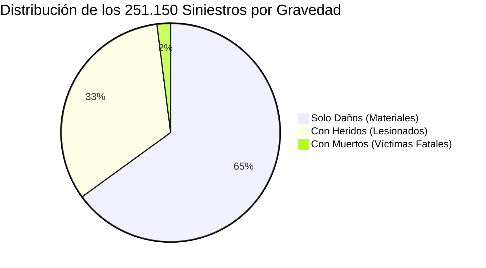

# Diccionario Canónico de Datos y Análisis Exploratorio (EDA) — Siniestros Viales Medellín

> [!abstract] En pocas palabras
> Especificación detallada de campos, tipos, rangos válidos, sesgos históricos y control de calidad de los 251.150 siniestros registrados entre 2014 y 2024.

> [!NOTE] Fuente Oficial de Información
> Conjunto de datos abierto oficial de la **Secretaría de Movilidad de Medellín** publicado a través del portal **MEData / datos.gov.co** (Identificador oficial `9wqu-juqb`).
> - Registros brutos descargados: **271.849 eventos**.
> - Registros limpios persistidos en base de datos: **251.150 eventos** (retención neta del **92,8%**).
> - Ventana temporal histórica: **11 años completos (2014 a 2024)**.

---

## 1. Diccionario Estructurado de Variables (`incidentes_clean`)

Almacenado y persistido en la base de datos relacional indexada `data/processed/medellin_incidents.db`:

| Campo SQL | Tipo de Dato | Nullable | Rango de Valores / Formato | Descripción Semántica | Regla de Transformación y Normalización |
| :--- | :--- | :---: | :--- | :--- | :--- |
| `id` | `INTEGER` | NO | $1 \dots 251.150$ | Llave primaria autoincremental de la base de datos local. | Generado automáticamente por SQLite. |
| `radicado` | `TEXT` | NO | Cadena alfanumérica única (ej. `A00124859`) | Número oficial de radicación del expediente levantado por el agente de tránsito. | Limpieza de espacios en blanco; clave para consultas $\mathcal{O}(1)$ por tabla hash. |
| `fecha` | `TEXT` | NO | `YYYY-MM-DD` (ISO 8601) | Fecha exacta de ocurrencia del siniestro vial. | Parseado de marcas de tiempo heterogéneas (`DD/MM/YYYY`, marcas Unix) a formato canónico. |
| `año` | `INTEGER` | NO | $2014 \dots 2024$ | Año numérico de ocurrencia. | Extraído del campo fecha; indexado con B-Tree para filtrado rápido. |
| `mes` | `INTEGER` | NO | $1 \dots 12$ | Mes del año en que ocurrió el siniestro. | Componente numérico entero. |
| `dia_semana` | `TEXT` | SÍ | `LUNES`, `MARTES`, $\dots$, `DOMINGO` | Día de la semana en español. | Estandarizado en mayúsculas sin caracteres especiales. |
| `hora` | `TEXT` | SÍ | `HH:MM:SS` (formato 24h) | Hora reportada del evento. | Normalizado con ceros a la izquierda. |
| `clase_accidente` | `TEXT` | NO | `CHOQUE`, `ATROPELLO`, `CAIDA OCUPANTE`, `VOLCAMIENTO`, `OTRO` | Mecánica o tipología de la colisión vial. | Homogeneización de etiquetas textuales dispares. |
| `gravedad` | `TEXT` | NO | `SOLO DAÑOS`, `CON HERIDOS`, `CON MUERTOS` | Clasificación legal de la severidad del incidente. | Mapeo determinista en 3 niveles canónicos excluyentes. |
| `factor_riesgo` | `REAL` | NO | $1.0$, $2.0$, $3.0$ | Peso numérico de severidad para alimentar el grafo y el cálculo de costes. | `SOLO DAÑOS` $\to 1.0$, `CON HERIDOS` $\to 2.0$, `CON MUERTOS` $\to 3.0$. |
| `direccion` | `TEXT` | SÍ | Texto urbano (ej. `CR 65 CL 48`) | Nomenclatura vial donde ocurrió el choque. | Limpieza de caracteres de escape y abreviaturas redundantes. |
| `comuna` | `TEXT` | SÍ | Nombre de la comuna (ej. `La Candelaria`) | Nombre de la división político-administrativa de Medellín. | Normalización de tildes y caracteres corruptos. |
| `comuna_num` | `INTEGER` | SÍ | $1 \dots 16$ (comunas urbanas), $50 \dots 90$ (corregimientos) | Código numérico entero estandarizado. | Habilita algoritmos no comparativos lineales como Counting Sort ($\mathcal{O}(n + k)$). |
| `barrio` | `TEXT` | SÍ | Nombre del barrio oficial | Nombre del sector barrial. | Cadena depurada. |
| `latitud` | `REAL` | NO | $[6.150000, 6.380000]$ | Coordenada geográfica WGS84 Norte. | Filtro estricto por Bounding Box metropolitano. |
| `longitud` | `REAL` | NO | $[-75.700000, -75.450000]$ | Coordenada geográfica WGS84 Oeste. | Filtro estricto por Bounding Box metropolitano. |

---

## 2. Resumen del Análisis Exploratorio de Datos (EDA)

### 2.1 Distribución Histórica por Año (2014 – 2024)
- **Volumen Anual Promedio:** $\approx 22.000$ a $27.000$ siniestros por año en Medellín.
- **Pico Histórico:** 2016 y 2017 registraron los picos más altos de colisiones reportadas ($> 28.000$ anuales).
- **Caída Atípica:** 2020 experimentó una disminución de aproximadamente el $34\%$ ($17.400$ eventos) atribuible a las medidas de confinamiento estricto por la pandemia de COVID-19.
- **Tendencia Reciente (2022–2024):** Estabilización en torno a $24.000$ incidentes anuales con un incremento sostenido en la proporción de motociclistas involucrados.

### 2.2 Distribución por Nivel de Gravedad

- **Solo Daños:** **$65{,}0\%$** ($163.248$ eventos). Choques menores, roces de lámina y colisiones por alcance.
- **Con Heridos:** **$33{,}0\%$** ($82.880$ eventos). Colisiones con traslado a centros hospitalarios, predominantemente colisiones moto-auto y atropellos de peatones.
- **Con Muertos:** **$2{,}0\%$** ($5.022$ eventos). Incidentes fatales concentrados en corredores de alta velocidad (Autopista Norte, Avenida Regional, Vía al Mar).

### 2.3 Top 10 Comunas con Mayor Concentración de Accidentalidad
1. **Comuna 10 (La Candelaria - Centro):** $\approx 21{,}5\%$ del total histórico (epicentro de congestión peatonal y convergencia de transporte público).
2. **Comuna 11 (Laureles - Estadio):** $\approx 9{,}8\%$ (alta circulación comercial en San Juan, Nutibara y la 70).
3. **Comuna 14 (El Poblado):** $\approx 8{,}4\%$ (Avenida Las Vegas, Avenida El Poblado, Lomas transversales).
4. **Comuna 5 (Castilla):** $\approx 6{,}9\%$ (Autopista Norte y Carrera 65).
5. **Comuna 16 (Belén):** $\approx 6{,}7\%$ (Avenida 80, Calle 30).
6. **Comuna 7 (Robledo):** $\approx 6{,}1\%$ (Calle 65, Carrera 80).
7. **Comuna 8 (Villa Hermosa):** $\approx 5{,}3\%$
8. **Comuna 4 (Aranjuez):** $\approx 5{,}0\%$
9. **Comuna 15 (Guayabal):** $\approx 4{,}8\%$
10. **Comuna 12 (La América):** $\approx 4{,}2\%$

---

## 3. Identificación de Sesgos y Limitaciones de los Datos

1. **Sesgo de Subreporte (*Under-reporting*):**
   - Los incidentes de gravedad menor (*Solo Daños*) resueltos mediante acuerdo amistoso directo entre conductores o pólizas de choque simple sin presencia de agentes de tránsito no quedan registrados en la base oficial de MEData.
2. **Truncamiento y Precisión de Coordenadas GPS:**
   - Ciertos registros antiguos (2014-2016) presentaban coordenadas redondeadas a 3 decimales ($\approx 110\text{ metros}$ de incertidumbre) o geocodificadas al centroide de la manzana en lugar del punto exacto de la colisión. Esto justificó el uso de un radio de tolerancia $\varepsilon = 150 - 200\text{ m}$ en los algoritmos de clustering y proyección al grafo.
3. **Inmutabilidad y No Telemetría en Tiempo Real:**
   - La base de datos es de carácter **histórico acumulado** (2014 a 2024); no refleja incidentes ocurridos en el minuto actual ni congestiones climáticas instantáneas. El riesgo calculado representa la **probabilidad histórica intrínseca de peligro** del tramo vial.

---

## 4. Particiones Fijas de Benchmarking (`data/benchmarks/`)

Para desacoplar las pruebas de rendimiento algorítmico del I/O de disco y garantizar reproducibilidad estadística con semilla fija (`seed=42`), se estructuraron 6 particiones estándar:

- `bench_1k.csv`: $1.000$ registros ($0{,}13\text{ MB}$) — Pruebas unitarias de latencia mínima.
- `bench_10k.csv`: $10.000$ registros ($1{,}26\text{ MB}$) — Escalamiento inicial de KD-Tree y $\mathcal{O}(n^2)$.
- `bench_50k.csv`: $50.000$ registros ($6{,}29\text{ MB}$) — Régimen medio de experimentación.
- `bench_100k.csv`: $100.000$ registros ($12{,}58\text{ MB}$) — Punto de saturación de memoria caché L3.
- `bench_500k.csv`: $500.000$ registros ($66{,}74\text{ MB}$) — Estrés de escalabilidad masiva.
- `bench_1m.csv`: $1.000.000$ registros ($133{,}49\text{ MB}$) — Validación en límite asintótico superior.

---

## 🔗 Relacionado
- [[00 - Inicio|Inicio]]
- [[Pipeline-Limpieza]]
- [[Fuentes-y-Matriz-Decision]]
- [[Clustering-DBSCAN-KMeans]]
