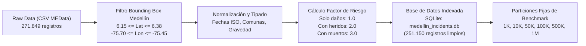

# Pipeline de Ingesta, Limpieza Geoespacial y Persistencia

> [!abstract] En pocas palabras
> Arquitectura del pipeline ETL: filtrado por Bounding Box WGS84 de Medellín, imputación, normalización espacial y almacenamiento en SQLite.


## 1. Arquitectura del Pipeline de Datos

El procesamiento de datos de siniestralidad vial de Medellín sigue un flujo unidireccional e inmutable diseñado para garantizar la reproducibilidad científica:



---

## 2. Decisiones de Limpieza y Reglas de Negocio

1. **Depuración de Coordenadas Geográficas:**
   - Registros con coordenadas nulas, ceros absolutos `(0.0, 0.0)` o coordenadas invertidas (latitud negativa en Colombia) fueron descartados sistemáticamente.
   - Bounding box estricto del Valle de Aburrá:
     $$\text{Latitud} \in [6.1500, 6.3800], \quad \text{Longitud} \in [-75.7000, -75.4500]$$
2. **Homogeneización de la Gravedad:**
   - Los textos dispares de la Secretaría de Movilidad fueron categorizados en tres niveles canónicos:
     - `SOLO DAÑOS` $\to$ Peso de riesgo base $w = 1.0$.
     - `CON HERIDOS` $\to$ Peso de riesgo moderado $w = 2.0$.
     - `CON MUERTOS` $\to$ Peso de riesgo crítico $w = 3.0$.
3. **Imputación y Consistencia de Comunas:**
   - Asignación de comunas numéricas estandarizadas (1 a 16 para Medellín, más corregimientos 50-90) para permitir la evaluación de algoritmos lineales como Counting Sort sobre dominios acotados $\mathcal{O}(n + k)$.

---

## 3. Esquema de la Base de Datos SQLite (`medellin_incidents.db`)

Para garantizar tiempos de respuesta sub-milisegundo en la API REST, la tabla `incidentes_clean` cuenta con índices B-Tree especializados:

```sql
CREATE TABLE IF NOT EXISTS incidentes_clean (
    id INTEGER PRIMARY KEY AUTOINCREMENT,
    radicado TEXT,
    fecha TEXT,
    año INTEGER,
    mes INTEGER,
    dia_semana TEXT,
    clase_accidente TEXT,
    gravedad TEXT,
    direccion TEXT,
    comuna TEXT,
    comuna_num INTEGER,
    latitud REAL,
    longitud REAL,
    factor_riesgo REAL
);

-- Índices B-Tree para optimización de consultas O(log N)
CREATE INDEX idx_fecha_año ON incidentes_clean (año, mes);
CREATE INDEX idx_comuna_num ON incidentes_clean (comuna_num);
CREATE INDEX idx_gravedad ON incidentes_clean (gravedad);
CREATE INDEX idx_geo_coords ON incidentes_clean (latitud, longitud);
```

---

## 4. Particiones Estandarizadas de Benchmarking

Para aislar el impacto del I/O de disco durante los experimentos de complejidad, se construyeron particiones deterministas en formato CSV en `data/benchmarks/`:

- `bench_1k.csv`: 1.000 registros (Pruebas unitarias y de latencia base).
- `bench_10k.csv`: 10.000 registros (Evaluación inicial de algoritmos $\mathcal{O}(n^2)$ y KD-Tree).
- `bench_50k.csv`: 50.000 registros (Régimen intermedio).
- `bench_100k.csv`: 100.000 registros (Cruce de jerarquía de caché L3).
- `bench_500k.csv`: 500.000 registros (Régimen masivo, verificación de estabilidad).
- `bench_1m.csv`: 1.000.000 registros (Estrés computacional y límite superior de análisis asintótico).

---

## 🔗 Relacionado
- [[00 - Inicio|Inicio]]
- [[Diccionario-Variables]]
- [[Estructuras-Espaciales-KDTree]]
- [[Clustering-DBSCAN-KMeans]]
