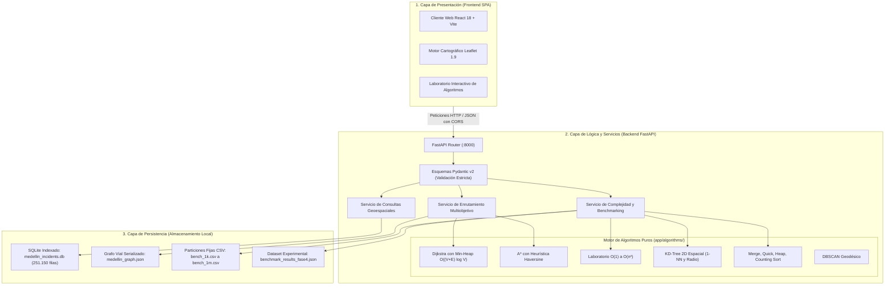

# Especificación Formal de la Capa de Backend y Contratos OpenAPI 3.1 — AburráSegura

> [!abstract] En pocas palabras
> Diseño modular de la API REST en FastAPI: esquemas Pydantic, routers versionados, manejo de errores y documentación Swagger/OpenAPI.


> [!NOTE] Arquitectura del Servidor Backend
> El servidor backend de **AburráSegura** está implementado en **Python 3.14 con el framework FastAPI** y validación estricta de datos mediante **Pydantic v2**. Opera como el núcleo computacional desacoplado que ejecuta los algoritmos puros implementados desde cero en memoria RAM y provee contratos RESTful bajo especificación OpenAPI 3.1 para el cliente web SPA en React.

---

## 1. Diagrama de Arquitectura de Tres Capas (Figura 1 de `AburráSegura.docx`)



---

## 2. Catálogo Formal de Endpoints REST (OpenAPI 3.1)

### 2.1 Enrutamiento Multiobjetivo por Identificadores de Nodo
- **Ruta:** `POST /api/v1/routing/calculate`
- **Descripción:** Calcula simultáneamente la **Ruta Más Corta** y la **Ruta Más Segura** mediante el Algoritmo de Dijkstra con cola de prioridad *min-heap* sobre el grafo de Medellín.
- **Request Body (JSON):**
  ```json
  {
    "origin_id": 1,
    "destination_id": 26,
    "alpha": 0.2,
    "beta": 0.8
  }
  ```
- **Response (200 OK):**
  ```json
  {
    "found": true,
    "origin": { "id": 1, "name": "Punto Cero", "lat": 6.2625, "lon": -75.5768 },
    "destination": { "id": 26, "name": "El Poblado - Cra 43A", "lat": 6.2089, "lon": -75.5681 },
    "shortest_route": {
      "path_nodes": [1, 5, 12, 19, 26],
      "path_coordinates": [[6.2625, -75.5768], [6.2512, -75.5710], [6.2089, -75.5681]],
      "total_distance_meters": 5210.4,
      "total_risk_score": 142.0,
      "nodes_explored": 28,
      "execution_time_ms": 1.24
    },
    "safest_route": {
      "path_nodes": [1, 7, 14, 20, 26],
      "path_coordinates": [[6.2625, -75.5768], [6.2580, -75.5820], [6.2089, -75.5681]],
      "total_distance_meters": 5740.1,
      "total_risk_score": 15.0,
      "risk_reduction_pct": 89.44,
      "nodes_explored": 31,
      "execution_time_ms": 1.48
    },
    "execution_time_total_ms": 2.72
  }
  ```
- **Errores:**
  - `404 Not Found`: Si `origin_id` o `destination_id` no existen en la red vial o no existe camino conexo (`RF-11`).
  - `422 Unprocessable Entity`: Parámetros `alpha` o `beta` fuera del rango $[0.0, 1.0]$.

---

### 2.2 Enrutamiento Continuo con Proyección Cartográfica
- **Ruta:** `POST /api/v1/routing/route-points`
- **Descripción:** Recibe coordenadas geográficas arbitrarias del lienzo de mapas, las proyecta a los nodos más cercanos con el `KDTree2D` ($\mathcal{O}(\log V)$), y devuelve la ruta completa con polyline continuo.
- **Request Body (JSON):**
  ```json
  {
    "origin_lat": 6.2625,
    "origin_lon": -75.5768,
    "dest_lat": 6.2089,
    "dest_lon": -75.5681,
    "alpha": 0.2,
    "beta": 0.8
  }
  ```
- **Response (200 OK):** Objeto con estructura de ruta, nombres de intersección aproximados y distancia total de puerta a puerta.

---

### 2.3 Laboratorio de Jerarquía Asintótica en Tiempo Real
- **Ruta:** `POST /api/v1/benchmarks/complexity`
- **Descripción:** Ejecuta en tiempo real sobre los datos reales de MEData una o todas las operaciones representativas de la jerarquía asintótica ($\mathcal{O}(1), \mathcal{O}(\log n), \mathcal{O}(n), \mathcal{O}(n \log n), \mathcal{O}(n^2)$), cronometrando nanosegundos con `time.perf_counter_ns()`.
- **Request Body (JSON):**
  ```json
  {
    "size_n": 10000,
    "complexity_class": "all" // "O(1)" | "O(log n)" | "O(n)" | "O(n log n)" | "O(n^2)" | "all"
  }
  ```
- **Response (200 OK):**
  ```json
  {
    "size_n": 10000,
    "hardware": {
      "processor": "AMD64 Family 23 Model 24 Stepping 1",
      "python_version": "3.14.3"
    },
    "results": [
      {
        "complexity_class": "O(1)",
        "name": "Acceso Directo por Tabla Hash",
        "time_ns": 120.4,
        "time_ms": 0.00012,
        "operations_count": 1,
        "is_extrapolated": false
      },
      {
        "complexity_class": "O(log n)",
        "name": "Búsqueda Binaria Temporal",
        "time_ns": 1240.5,
        "time_ms": 0.00124,
        "operations_count": 14,
        "is_extrapolated": false
      },
      {
        "complexity_class": "O(n)",
        "name": "Escaneo Secuencial por Comuna",
        "time_ns": 1952000.0,
        "time_ms": 1.952,
        "operations_count": 10000,
        "is_extrapolated": false
      },
      {
        "complexity_class": "O(n log n)",
        "name": "Merge Sort Puro Recursivo",
        "time_ns": 56830000.0,
        "time_ms": 56.83,
        "operations_count": 120448,
        "is_extrapolated": false
      },
      {
        "complexity_class": "O(n^2)",
        "name": "Comparación Exhaustiva de Pares",
        "time_ns": 7542100000.0,
        "time_ms": 7542.1,
        "operations_count": 49995000,
        "is_extrapolated": false
      }
    ]
  }
  ```

---

### 2.4 Matriz Consolidada de Benchmarking Masivo
- **Ruta:** `GET /api/v1/benchmarks/fase4-results`
- **Descripción:** Entrega instantáneamente el dataset experimental precongelado de las 6 particiones masivas ($1.000$ a $1.000.000$ de elementos) para alimentar las gráficas comparativas del frontend sin saturar el procesador cliente.

---

### 2.5 Catálogo Paginado de Siniestros y Puntos Críticos (Hotspots)
- **Rutas:**
  - `GET /api/v1/incidents/` (Parámetros: `skip`, `limit`, `año`, `gravedad`, `comuna`). Retorna lista paginada de incidentes desde SQLite.
  - `GET /api/v1/incidents/hotspots` (Parámetros: `limit=20`, `gravedad`). Retorna las intersecciones de Medellín con mayor concentración histórica de colisiones para dibujar los halos rojos en el mapa.

---

### 2.6 Estado Operativo (Healthcheck)
- **Ruta:** `GET /health`
- **Response (200 OK):**
  ```json
  {
    "status": "healthy",
    "project": "AburráSegura - PPI Análisis de Algoritmos",
    "version": "2.1.0",
    "total_incidents_loaded": 251150,
    "road_network_nodes": 32,
    "road_network_edges": 84
  }
  ```

---

## 3. Manejo de Errores y Seguridad (CORS)
- **Middleware CORS:** Habilitado para permitir orígenes `http://localhost:5173`, `http://127.0.0.1:5173` y accesos en red de área local para dispositivos móviles en pruebas vehiculares.
- **Validación Automática Pydantic:** Todo parámetro inválido (ej. cadenas en lugar de números flotantes en latitud) responde automáticamente con código `422 Unprocessable Entity` detallando el campo defectuoso.

---

## 🔗 Relacionado
- [[00 - Inicio|Inicio]]
- [[ADR-002-Arquitectura-FastAPI-React|ADR-002]]
- [[Grafos-Dijkstra-AStar]]
- [[Diseno-Frontend-UI]]
- [[Plan-Pruebas-QA]]
