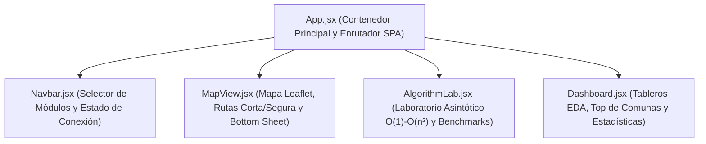
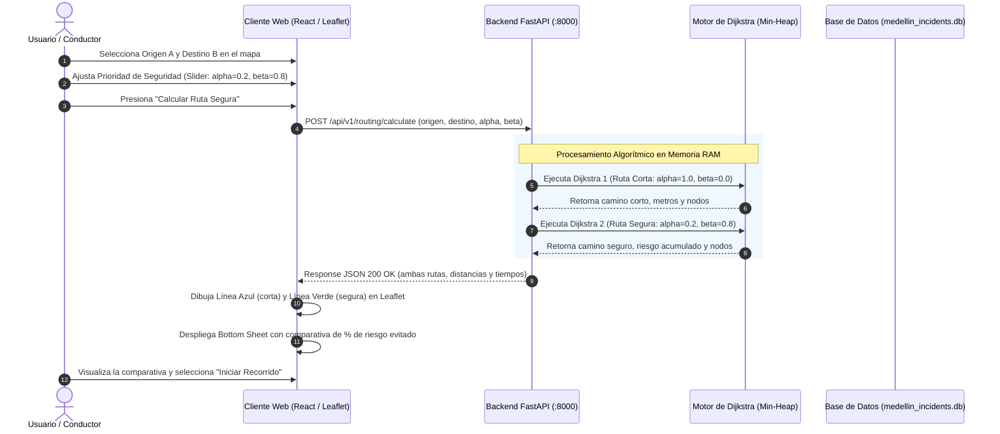

# Diseño de Interfaz de Usuario (UI/UX) y Arquitectura de Componentes — AburráSegura

> [!abstract] En pocas palabras
> Arquitectura de componentes de la interfaz de usuario en React, visualización de rutas sobre mapa interactivo Leaflet y gráficos de complejidad.

> [!NOTE] Enfoque de Diseño Mobile-First
> La interfaz de **AburráSegura** está concebida bajo la premisa **Mobile-First** (pantalla de relación de aspecto 9:16 típica de smartphones), pues motociclistas, ciclistas y conductores particulares consultan rutas preventivas directamente montados en sus vehículos. No obstante, el sistema incorpora diseño adaptable (responsive design) para extenderse con comodidad a tablets y pantallas de escritorio.

---

## 1. Tokens de Diseño y Paleta Cromática Semántica

Los colores de la aplicación no son meramente estéticos; transmiten información semántica inmediata para minimizar la carga cognitiva del usuario:

| Token / Color | Código Hex | Rol en la Interfaz | Significado Semántico |
| :--- | :---: | :--- | :--- |
| **Verde Esmeralda** | `#10B981` / `#047857` | **Identidad y Seguridad** | Color corporativo de la marca. Resalta la **Ruta Más Segura**, el botón de acción principal y los porcentajes de riesgo evitado. |
| **Azul Vibrante** | `#2563EB` / `#3B82F6` | **Distancia Estándar** | Representa la métrica geométrica convencional y la **Ruta Más Corta** tradicional. |
| **Rojo Alerta** | `#EF4444` / `#DC2626` | **Peligro y Hotspots** | Señaliza los puntos críticos de alta siniestralidad (*hotspots* como Glorieta de la 33 o Punto Cero) y el marcador de Destino B. |
| **Fondo Neutro Claro** | `#F8FAFC` / `#FFFFFF` | **Superficies y Tarjetas** | Fondos de alto contraste para máxima legibilidad bajo la luz solar directa del día. |
| **Gris Pizarra Oscuro** | `#0F172A` / `#1E293B` | **Tipografía y Header Académico** | Provee contraste visual de nivel AAA (WCAG 2.1) para textos de métricas y encabezados técnicos. |

---

## 2. Especificación Detallada de Pantallas y Mockups (Sección 4.3 de `AburráSegura.docx`)

### Mockup 1: Pantalla Principal y Selección de Ruta (Inicio)
- **Cabecera (Header):**
  - Fondo blanco limpio con sombra suave (`shadow-sm`).
  - Logotipo institucional de **AburráSegura** con icono de escudo en verde esmeralda.
  - Indicador de estado de conexión con el backend y precisión del GPS.
- **Tarjeta Flotante de Búsqueda:**
  - **Campo Origen A:** Icono de círculo verde (`#10B981`), autocompletado y botón con mira telescópica: *"Usar mi ubicación actual"* (invoca la API de Geolocalización WGS84 del navegador).
  - **Campo Destino B:** Icono de pin rojo (`#EF4444`) con catálogo predictivo de más de 40 hitos de Medellín (ej. *Tecnológico de Antioquia*, *Parque Berrío*, *Hospital San Vicente*, *Universidad de Medellín*).
  - **Botón de Intercambio Rápido ($\updownarrow$):** Permite invertir instantáneamente los puntos de partida y llegada con un solo toque.
- **Control Deslizante de Aversión al Riesgo (Slider de Seguridad):**
  - Barra deslizante horizontal interactiva de 0% a 100%.
  - Al regularla, recalcula dinámicamente los coeficientes $\alpha$ (distancia) y $\beta$ (seguridad) en la función de coste de Dijkstra.
- **Botón de Acción Primario:**
  - Botón verde esmeralda de ancho completo: **"▶ CALCULAR RUTA SEGURA"**.

---

### Mockup 2: Visualización y Comparativa de Rutas en el Mapa
- **Lienzo Cartográfico (Leaflet 1.9):**
  - Mapa interactivo centrado en las coordenadas del Valle de Aburrá con teselas abiertas de OpenStreetMap.
  - Marcadores de origen (A) y destino (B) interactivos con soporte de arrastre en vivo (`draggable`).
  - **Línea Azul (Ruta Más Corta):** Dibuja el trayecto directo en línea continua azul (`#2563EB`, grosor 5px), cruzando directamente a través de círculos rojos translúcidos (zonas de alta colisión).
  - **Línea Verde Esmeralda (Ruta Más Segura):** Dibuja el trayecto calculado por Dijkstra con $\alpha=0.2, \beta=0.8$ (`#10B981`, grosor 6px), realizando desvíos controlados por vías secundarias o colectoras y esquivando los halos rojos de accidentalidad.
- **Tarjeta Inferior Desplegable (*Bottom Sheet* Comparativo):**
  - Se despliega suavemente desde la parte inferior de la pantalla sin tapar el mapa.
  - **Columna Azul (Más Corta):** Distancia: `5.2 km` | Siniestros históricos: `38 choques`.
  - **Columna Verde (Más Segura - Destacada):** Distancia: `5.7 km` (+500 m) | Siniestros históricos: `4 choques` | **¡Ahorras 89.4% de exposición al peligro!**
  - Botón de confirmación: *"Iniciar Navegación"*.

---

### Mockup 3: Laboratorio de Rendimiento y Complejidad Algorítmica (Módulo Académico)
- **Cabecera Técnica:** Barra azul noche (`#0F172A`) con selector de vistas: *"Matriz Masiva (1K - 1M)"* vs. *"Ejecución en Vivo"*.
- **Controles de Experimentación:**
  - Selector de tamaño de entrada $n$: `[1.000]`, `[10.000]`, `[50.000]`, `[100.000]`, `[250.000+]`.
  - Selector de clase asintótica: pestañas `[O(1)]`, `[O(log n)]`, `[O(n)]`, `[O(n log n)]`, `[O(n²)]` o `[Ejecutar Todas]`.
- **Panel de Métricas en Tiempo Real (Tarjetas HUD):**
  1. **Tiempo Neto de CPU:** Cronometrado en milisegundos y nanosegundos (`time.perf_counter_ns`).
  2. **Operaciones Primitivas:** Conteo exacto de comparaciones de claves o pares espaciales evaluados.
  3. **Memoria RAM Peak:** Pico de memoria asignado durante la corrida (`tracemalloc`).
  4. **Cota Teórica Asignada:** Expresión matemática en formato LaTeX ($\mathcal{O}(n \log n)$).
- **Lienzo Gráfico Vectorial (SVG / Recharts):**
  - Superpone la **curva empírica medida $T(n)$** sobre la **curva teórica normalizada $c \cdot g(n)$**, permitiendo al evaluador apreciar visualmente el cambio de pendiente entre el régimen lineal y el cuadrático.

---

### Mockup 4: Mapa de Puntos Críticos y Consulta Histórica (Hotspots)
- **Capa de Mapa de Calor (*Heatmap*):** Gradiente de densidad de Kernel (amarillo a rojo escarlata) sobre las avenidas neurálgicas de la ciudad.
- **Filtros Rápidos por Severidad:**
  - `[Todos (251K)]`
  - `[Solo daños (163K)]`
  - `[Con heridos (82K)]`
  - `[Con muertos (5K)]`
- **Ventana Emergente Interactiva (*Popup* Leaflet):** Al tocar un halo rojo en el mapa, despliega el nombre de la intersección (ej. *Glorieta San Diego*), el número exacto de incidentes registrados en la década y los años de mayor recurrencia.

---

## 3. Jerarquía de Componentes en React 18

### Detalle de Componentes Fuente (`frontend/src/components/`):
1. **`App.jsx`:** Gestiona el estado global de la aplicación (módulo activo: `map`, `lab`, `dashboard`), el estado de carga y el tema visual.
2. **`Navbar.jsx`:** Barra de navegación superior con pestañas rápidas y badge de salud del backend (`/health`).
3. **`MapView.jsx`:** Monta el contenedor `MapContainer` de React-Leaflet, gestiona las capas de polilíneas vectoriales para las dos rutas, renderiza los marcadores arrastrables y envía las peticiones a `/api/v1/routing/calculate`.
4. **`AlgorithmLab.jsx`:** Implementa la interfaz del laboratorio de complejidad conectada a `/api/v1/benchmarks/complexity` y `/api/v1/benchmarks/fase4-results`, renderizando las tablas de tiempos y gráficas SVG.
5. **`Dashboard.jsx`:** Presenta las tarjetas de resumen descriptivo del conjunto de 251.150 siniestros de MEData y los rankings por comuna y gravedad.

---

## 4. Diagrama de Secuencia del Flujo de Usuario (Figura 2 de `AburráSegura.docx`)

---

## 🔗 Relacionado
- [[00 - Inicio|Inicio]]
- [[Diseno-Backend-API]]
- [[Manual-Usuario-Prototipo]]
- [[ADR-002-Arquitectura-FastAPI-React|ADR-002]]
