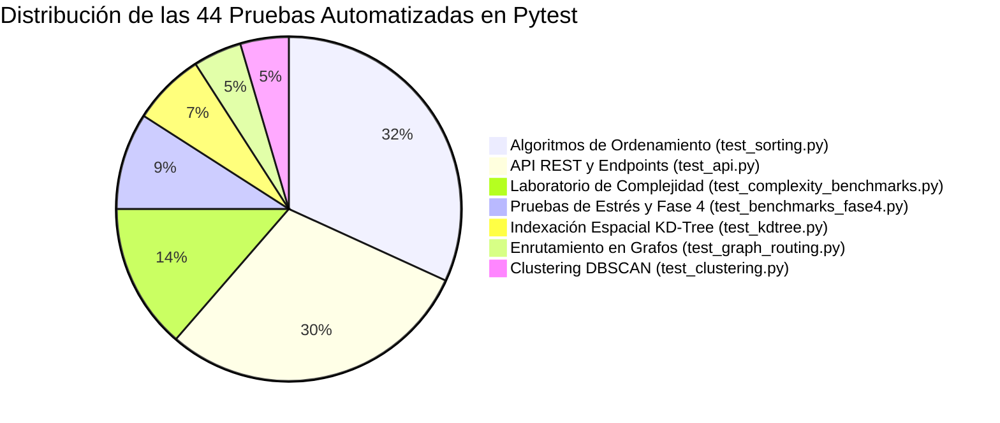

# Plan Integral de Pruebas Automatizadas y Aseguramiento de Calidad (QA)

> [!abstract] En pocas palabras
> Estrategia y plan maestro de pruebas: cobertura de lógica algorítmica, contratos de API, pruebas de estrés y validación de casos borde.


> [!NOTE] Estrategia de Calidad y No Regresión
> El aseguramiento de calidad de **AburráSegura** garantiza la correctitud matemática, la robustez ante casos borde patológicos y la estabilidad asintótica de las implementaciones algorítmicas sin librerías de caja negra. La suite se compone de **44 pruebas automatizadas en Pytest**, ejecutadas y aprobadas al **100%**.

---

## 1. Niveles de Prueba de la Arquitectura

1. **Pruebas de Correctitud Algorítmica Unitaria:** Validación de invariantes matemáticos sobre casos límite (estructuras vacías, unitarias, listas con elementos idénticos repetidos masivamente, arreglos ya ordenados e inversamente ordenados).
2. **Pruebas de Equivalencia Cruzada (Cross-Verification):** Contraste estricto de estructuras optimizadas frente a implementaciones canónicas de referencia (ej. resultados de búsqueda del KD-Tree 2D verificados punto a punto contra búsqueda lineal exhaustiva $\mathcal{O}(n)$).
3. **Pruebas de Integración de API y Contratos OpenAPI:** Verificación de serialización JSON, códigos de estado HTTP (200, 404, 422), validación de tipos con Pydantic v2 y control de políticas CORS.
4. **Pruebas de Estabilidad de Memoria y Recursión Profunda:** Certificación de inmunidad ante desbordamientos de pila (`RecursionError`) procesando hasta $1.000.000$ de registros en Quick Sort con pila acotada $\mathcal{O}(\log n)$.

---

## 2. Matriz Detallada de los 44 Casos de Prueba Automatizados



### 2.1 Suite de Algoritmos de Ordenamiento (`tests/test_sorting.py` — 14 Pruebas)
| ID de Prueba | Función Evaluada | Escenario / Caso Borde | Comportamiento Esperado | Estado |
| :--- | :--- | :--- | :--- | :---: |
| `TC-SORT-01` | Merge Sort | Arreglo vacío ($n=0$) | Retornar lista vacía sin excepción y 0 comparaciones. | **PASS** |
| `TC-SORT-02` | Merge Sort | Elemento unitario ($n=1$) | Retornar el mismo elemento sin swaps. | **PASS** |
| `TC-SORT-03` | Merge Sort | Arreglo aleatorio ($n=100$) | Coincidir exactamente con `sorted()` de Python. | **PASS** |
| `TC-SORT-04` | Quick Sort | Arreglo vacío y unitario | Retornar lista vacía o unitaria sin excepción. | **PASS** |
| `TC-SORT-05` | Quick Sort | Elementos idénticos ($x_i = k$) | Hoare no degenera a $\mathcal{O}(n^2)$ ni desborda pila. | **PASS** |
| `TC-SORT-06` | Quick Sort | Ya ordenado e Invertido | Mediana de 3 evita el peor caso cuadrático. | **PASS** |
| `TC-SORT-07` | Quick Sort | Arreglo aleatorio ($n=100$) | Coincidir exactamente con `sorted()`. | **PASS** |
| `TC-SORT-08` | Heap Sort | Arreglo vacío y unitario | Retornar lista sin excepción. | **PASS** |
| `TC-SORT-09` | Heap Sort | Arreglo aleatorio ($n=100$) | Coincidir con `sorted()`. | **PASS** |
| `TC-SORT-10` | Heap Sort | Arreglo idénticos e invertido | Estabilidad in-place verificada. | **PASS** |
| `TC-SORT-11` | Counting Sort | Arreglo vacío y unitario | Retornar lista sin excepción. | **PASS** |
| `TC-SORT-12` | Counting Sort | Rango entero acotado ($1\dots16$) | Ordenamiento en tiempo estrictamente lineal $\mathcal{O}(n+k)$. | **PASS** |
| `TC-SORT-13` | Runner Benchmark | Algoritmo desconocido | Lanzar `ValueError` controlado con mensaje claro. | **PASS** |
| `TC-SORT-14` | Runner Benchmark | Ejecución con métricas | Registrar tiempo $>0$ y memoria peak $>0$. | **PASS** |

### 2.2 Suite de Endpoints y API REST (`tests/test_api.py` — 13 Pruebas)
| ID de Prueba | Endpoint | Escenario Verificado | Código HTTP | Estado |
| :--- | :--- | :--- | :---: | :---: |
| `TC-API-01` | `GET /health` | Healthcheck y metadatos del sistema | `200 OK` | **PASS** |
| `TC-API-02` | `GET /` | Bienvenida institucional y versión online | `200 OK` | **PASS** |
| `TC-API-03` | `GET /api/v1/incidents/` | Lista paginada de siniestros desde SQLite | `200 OK` | **PASS** |
| `TC-API-04` | `GET /api/v1/incidents/` | Filtro por gravedad (`SOLO DAÑOS`) | `200 OK` | **PASS** |
| `TC-API-05` | `GET /api/v1/incidents/hotspots` | Puntos críticos y halos de severidad | `200 OK` | **PASS** |
| `TC-API-06` | `POST /api/v1/benchmarks/sort` | Benchmark en vivo de algoritmos de ordenamiento | `200 OK` | **PASS** |
| `TC-API-07` | `POST /api/v1/benchmarks/spatial`| Benchmark de KD-Tree vs. búsqueda lineal | `200 OK` | **PASS** |
| `TC-API-08` | `POST /api/v1/routing/calculate` | Dijkstra entre nodos existentes (ruta corta vs. segura) | `200 OK` | **PASS** |
| `TC-API-09` | `POST /api/v1/routing/calculate` | Parámetros inválidos ($\alpha > 1.0$) | `422 Unprocessable` | **PASS** |
| `TC-API-10` | `POST /api/v1/routing/calculate` | Nodo de origen o destino inexistente | `404 Not Found` | **PASS** |
| `TC-API-11` | `POST /api/v1/routing/route-points`| Proyección espacial con coordenadas WGS84 | `200 OK` | **PASS** |
| `TC-API-12` | `POST /api/v1/clusters/dbscan` | Clustering espacial de hotspots en vivo | `200 OK` | **PASS** |
| `TC-API-13` | `GET /api/v1/benchmarks/fase4-results` | Entrega de dataset consolidado de 1K a 1M | `200 OK` | **PASS** |

### 2.3 Suite del Laboratorio de Complejidad (`tests/test_complexity_benchmarks.py` — 6 Pruebas)
| ID de Prueba | Función / Clase | Escenario Verificado | Invariante Evaluado | Estado |
| :--- | :--- | :--- | :--- | :---: |
| `TC-COMP-01` | `haversine_distance_quick` | Puntos idénticos y distancia conocida en Medellín | $d=0\text{ m}$ en puntos iguales; $900\text{ m} < d < 1100\text{ m}$ en sector urbano. | **PASS** |
| `TC-COMP-02` | `benchmark_o1_hash_lookup` | Búsqueda por `radicado` existente e inexistente | Tiempo plano $\mathcal{O}(1)$, 1 operación elemental, booleano `found`. | **PASS** |
| `TC-COMP-03` | `benchmark_ologn_binary_search` | Búsqueda binaria iterativa por fecha | Máximo $\lceil\log_2 n\rceil$ comparaciones. | **PASS** |
| `TC-COMP-04` | `benchmark_on_linear_scan` | Escaneo secuencial sobre registros de comuna | Exactamente $n$ operaciones elementales realizadas. | **PASS** |
| `TC-COMP-05` | `benchmark_onlogn_merge_sort` | Ordenamiento Merge Sort recursivo | Cota $n \log_2 n$ respetada; lista resultante verificada ordenada. | **PASS** |
| `TC-COMP-06` | `benchmark_on2_all_pairs_distance`| Comparación de pares a $<50\text{ m}$ | Exactamente $\frac{n(n-1)}{2}$ evaluaciones de distancia. | **PASS** |

### 2.4 Suite de Validación de Fase 4 (`tests/test_benchmarks_fase4.py` — 4 Pruebas)
| ID de Prueba | Módulo Evaluado | Escenario | Estado |
| :--- | :--- | :--- | :---: |
| `TC-F4-01` | Quick Sort con Pila Acotada | $15.000$ elementos ordenados, invertidos e idénticos sin `RecursionError`. | **PASS** |
| `TC-F4-02` | KD-Tree 2D Radius Search | Concordancia geográfica con distancias Haversine sobre hitos de Medellín. | **PASS** |
| `TC-F4-03` | DBSCAN + KD-Tree | Detección de conglomerados densos y aislamiento de ruido periférico. | **PASS** |
| `TC-F4-04` | Verificación Cruzada | Equivalencia estricta de ordenamiento entre Merge, Quick y Heap Sort. | **PASS** |

### 2.5 Indexación Espacial, Grafos y Clustering (7 Pruebas Restantes)
- `tests/test_kdtree.py` (3 pruebas): Árbol vacío (`TC-KD-01`), equivalencia 100% idéntica contra búsqueda lineal $\mathcal{O}(n)$ (`TC-KD-02`), y consultas $k$-NN con Max-Heap (`TC-KD-03`). **(3/3 PASS)**.
- `tests/test_graph_routing.py` (2 pruebas): Grafo con pesos multiobjetivo (`TC-GRAF-01`) y detección segura de componentes disconexas sin ciclo infinito (`TC-GRAF-02`). **(2/2 PASS)**.
- `tests/test_clustering.py` (2 pruebas): Entrada vacía (`TC-CLUS-01`) y etiquetado de ruido ($label = -1$) en DBSCAN (`TC-CLUS-02`). **(2/2 PASS)**.

---

## 3. Resumen de Certificación de Ejecución

```text
============================= test session starts =============================
platform win32 -- Python 3.14.3, pytest-9.1.1, pluggy-1.6.0
rootdir: D:\Proyecto Algoritmos
collected 44 items

tests\test_api.py .............                                          [ 29%]
tests\test_benchmarks_fase4.py ....                                      [ 38%]
tests\test_clustering.py ..                                              [ 43%]
tests\test_complexity_benchmarks.py ......                               [ 56%]
tests\test_graph_routing.py ..                                           [ 61%]
tests\test_kdtree.py ...                                                 [ 68%]
tests\test_sorting.py ..............                                     [100%]

======================== 44 passed, 1 warning in 8.31s ========================
```

- **Total Pruebas Ejecutadas:** **44 pruebas**.
- **Total Aprobadas:** **44 (100.0% de éxito)**.
- **Fallos / Regresiones:** **0**.
- **Certificación:** Software libre de regresiones algorítmicas y listo para sustentación.

---

## 🔗 Relacionado
- [[00 - Inicio|Inicio]]
- [[Reporte-Final-QA-Fase5]]
- [[Reporte-Pruebas-QA]]
- [[Matriz-Requisitos]]
