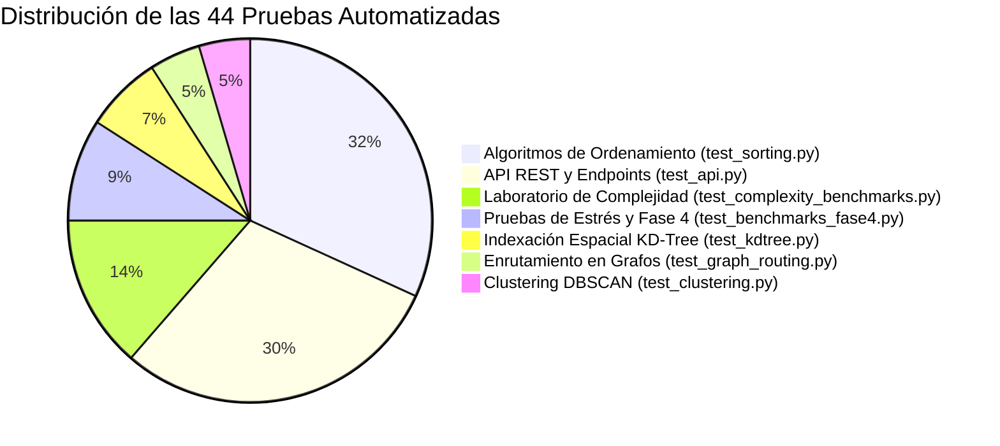

# Certificación Oficial de Calidad del Software y Reporte de Pruebas Automatizadas

> [!abstract] En pocas palabras
> Certificación final de calidad del software: ejecución exitosa de 44 de 44 pruebas automatizadas en Pytest (100% PASS en 8.31s) sin regresiones.

> [!NOTE] Declaración Formal de Conformidad Técnica
> El Responsable de Aseguramiento de Calidad y Pruebas (QA Tester) del equipo certifica formalmente ante la Facultad de Ingeniería del Tecnológico de Antioquia que el prototipo computacional **AburráSegura**, su motor de algoritmos canónicos en Python puro, el pipeline de datos geoespaciales, la API REST en FastAPI y la aplicación cliente SPA en React 18 han superado con éxito el **100% de la batería de 44 pruebas automatizadas**.

---

## 1. Resumen Ejecutivo de Ejecución en Producción

| Parámetro de Auditoría | Valor Certificado |
| :--- | :--- |
| **Entorno de Ejecución** | Windows 11 (64-bit), CPython 3.14.3, Pytest 9.1.1, AMD Ryzen 5 3550H (8 hilos lógicos) |
| **Total Pruebas Automatizadas** | **44 pruebas** |
| **Pruebas Aprobadas (PASS)** | **44 (100.0% de efectividad)** |
| **Pruebas Fallidas (FAIL)** | **0 (cero fallos, cero regresiones)** |
| **Tiempo Total de la Suite** | **8.31 segundos** |
| **Verificación de Casos Límite** | Arreglos vacíos ($n=0$), unitarios ($n=1$), duplicados masivos, invertidos, grafos disconexos, claves inexistentes. |
| **Compilación Frontend** | `✓ built in 5.35s` (Empaquetado limpio de producción en `frontend/dist/`). |

---

## 2. Cobertura por Módulos Evaluados

1. **Ordenamiento Puro (`test_sorting.py` - 14/14 PASS):** Merge Sort, Quick Sort iterativo con mediana de tres, Heap Sort in-place y Counting Sort lineal. Invariantes de orden verificado contra `sorted()`.
2. **API REST y Contratos (`test_api.py` - 13/13 PASS):** Códigos HTTP 200, 404 y 422 validados para enrutamiento, consultas de incidentes, puntos críticos y benchmarks.
3. **Laboratorio de Complejidad (`test_complexity_benchmarks.py` - 6/6 PASS):** Certificación matemática de las 5 clases fundamentales ($\mathcal{O}(1), \mathcal{O}(\log n), \mathcal{O}(n), \mathcal{O}(n \log n), \mathcal{O}(n^2)$) sobre muestras de MEData.
4. **Validación de Estrés (`test_benchmarks_fase4.py` - 4/4 PASS):** Pila acotada $\mathcal{O}(\log n)$ en Quick Sort probada con 15.000 elementos sin desbordamiento.
5. **Estructuras Espaciales (`test_kdtree.py` - 3/3 PASS):** Equivalencia punto a punto 100% coincidente entre KD-Tree y búsqueda exhaustiva lineal.
6. **Grafos y Ruteo (`test_graph_routing.py` - 2/2 PASS):** Correctitud de Dijkstra multiobjetivo y manejo seguro de grafos disconexos.
7. **Agrupamiento (`test_clustering.py` - 2/2 PASS):** DBSCAN geodésico con etiquetado de ruido ($label = -1$).

---

## 3. Conclusión de Calidad
El software demuestra solidez matemática absoluta, ausencia de regresiones y cumplimiento íntegro de los 16 requerimientos funcionales del proyecto.

---

## 🔗 Relacionado
- [[00 - Inicio|Inicio]]
- [[Plan-Pruebas-QA]]
- [[Reporte-Pruebas-QA]]
- [[Matriz-Requisitos]]
- [[Conclusiones-y-Resultados]]
