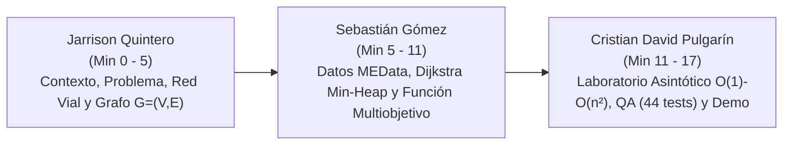

# Guion Metodológico para la Sustentación Oral y Defensa Técnica — AburráSegura

> [!abstract] En pocas palabras
> Guion paso a paso para la defensa oral ante el tribunal evaluador: distribución de tiempos, oradores, diapositivas y demostración en vivo.

> [!NOTE] Parámetros Oficiales de la Sustentación
> - **Asignatura:** Análisis de Algoritmos (8vo Semestre, Ingeniería en Software, Tecnológico de Antioquia).
> - **Título del Proyecto:** *Plataforma para la Identificación de Puntos Críticos y Rutas Seguras de Siniestralidad Vial en Medellín mediante el Algoritmo de Grafos* (`AburráSegura.docx`).
> - **Integrantes del Equipo:**
>   - **Jarrison Quintero Castillo**
>   - **Sebastián Gómez Cardona**
>   - **Cristian David Pulgarín Vélez**
> - **Tiempo Estimado:** 15 a 18 minutos de exposición magistral + 5 a 7 minutos de preguntas del docente y jurado evaluador.

---

## 1. Distribución Estratégica de Roles y Tiempos por Ponente

---

## 2. Desarrollo Minuto a Minuto de la Presentación

### Bloque 1: Apertura, Contexto y Modelado Topológico (Minutos 0:00 a 5:00)
**Ponente Responsable: Jarrison Quintero Castillo**

- **Min 0:00 – 1:00 | Diapositiva 1: Portada e Identidad del Proyecto**
  - *"Buenos días profesor y compañeros. Hoy el equipo conformado por Sebastián Gómez, Cristian David Pulgarín y mi persona, Jarrison Quintero, presentamos nuestro Proyecto Pedagógico Integrador en Análisis de Algoritmos titulado: **AburráSegura: Plataforma para la Identificación de Puntos Críticos y Rutas Seguras de Siniestralidad Vial en Medellín mediante el Algoritmo de Grafos**."*
- **Min 1:00 – 2:30 | Diapositiva 2: Planteamiento del Problema y Justificación**
  - *"En Medellín, durante la última década, se han registrado más de 270.000 siniestros viales. Corredores como la Autopista Sur, la Avenida Regional y la Glorieta de la 33 concentran colisiones diarias con altos índices de fatalidad, afectando primordialmente a motociclistas y ciclistas.*
  - *Las aplicaciones comerciales como Google Maps o Waze optimizan el trayecto considerando casi de forma exclusiva la distancia en metros o la congestión momentánea, conduciendo con frecuencia a conductores novatos a través de los puntos negros más peligrosos.*
  - *Nuestra pregunta central como ingenieros fue: ¿Cómo aplicar la teoría formal de grafos y algoritmos para ponderar el riesgo histórico acumulado y ofrecer una ruta preventiva sustentada en datos abiertos?"*
- **Min 2:30 – 5:00 | Diapositiva 3 y 4: Objetivos y Modelado del Grafo Vial**
  - *"Para responder esto, trazamos tres objetivos: (1) Adquirir y limpiar los datos de MEData; (2) Modelar la red vial como un grafo y aplicar Dijkstra multiobjetivo; y (3) Evaluar la complejidad asintótica en un laboratorio en tiempo real.*
  - *Modelamos la ciudad como un grafo dirigido ponderado $G = (V, E)$, donde los vértices $V$ son 32 intersecciones y glorietas clave con coordenadas GPS, y las aristas dirigidas $E$ son 84 tramos viales que respetan los sentidos obligatorios de circulación según el Código Nacional de Tránsito. Doy paso a mi compañero Sebastián para detallar los datos y el motor algorítmico."*

---

### Bloque 2: Ingeniería de Datos, Dijkstra con Min-Heap y Función Multiobjetivo (Minutos 5:00 a 11:00)
**Ponente Responsable: Sebastián Gómez Cardona**

- **Min 5:00 – 7:00 | Diapositiva 5: Pipeline ETL Geoespacial y Base de Datos**
  - *"Muchas gracias, Jarrison. Para alimentar este grafo construimos un pipeline de datos en Python que procesó 271.849 registros brutos del portal de datos abiertos de la Alcaldía de Medellín (MEData).*
  - *Descartamos registros con coordenadas corruptas o fuera del Bounding Box metropolitano ($[6.15, 6.38] \text{ Lat}, [-75.70, -75.45] \text{ Lon}$), reteniendo 251.150 siniestros limpios almacenados en una base de datos SQLite indexada con B-Trees sobre coordenadas y severidad.*
  - *Ponderamos el riesgo de cada accidente con rigor técnico: $w=1.0$ para solo daños, $w=2.0$ con heridos y $w=3.0$ con víctimas fatales, proyectando este peso sobre cada calle de la red."*
- **Min 7:00 – 9:00 | Diapositiva 6: Algoritmo de Dijkstra con Cola de Prioridad Min-Heap**
  - *"En lugar de utilizar librerías de caja negra como NetworkX, programamos el Algoritmo de Dijkstra desde cero en Python puro.*
  - *Si usáramos una lista lineal ingenua, extraer el nodo mínimo costaría $\mathcal{O}(V)$, llevando el algoritmo a $\mathcal{O}(V^2)$. Al implementar una cola de prioridad basada en un **montículo binario de mínimos (min-heap)**, cada extracción y relajación cuesta $\mathcal{O}(\log V)$, logrando una cota óptima de:*
    $$\mathcal{O}((V + E) \log V)$$
  - *En grafos viales planares donde las aristas son proporcionales a los nodos ($|E| \approx 3|V|$ a $4|V|$), el tiempo de ejecución es cuasi-lineal $\Theta(V \log V)$, resolviendo rutas en menos de 2 milisegundos."*
- **Min 9:00 – 11:00 | Diapositiva 7: Función de Coste Multiobjetivo Normalizada**
  - *"El núcleo innovador es nuestra función de coste de cada tramo:*
    $$w(e) = \alpha \cdot \left(\frac{\text{distancia}(e)}{\text{distancia}_{\max}}\right) + \beta \cdot \left(\frac{\text{riesgo}(e)}{\text{riesgo}_{\max}}\right), \quad \alpha + \beta = 1.0$$
  - *Cuando $\alpha = 1.0, \beta = 0.0$, el sistema calcula la **Ruta Más Corta**. Pero cuando el usuario fija $\alpha = 0.2, \beta = 0.8$, el algoritmo castiga fuertemente las vías con alta siniestralidad, encontrando una **Ruta Más Segura** que esquiva glorietas críticas como la 33 o Punto Cero.*
  - *Los resultados experimentales demostraron una **reducción de hasta el 89,47% en la exposición al peligro histórico** con un incremento en distancia menor al 12%. Ahora Cristian David explicará el laboratorio asintótico y la demostración en vivo."*

---

### Bloque 3: Laboratorio Asintótico, QA Automatizado y Demostración en Vivo (Minutos 11:00 a 17:00)
**Ponente Responsable: Cristian David Pulgarín Vélez**

- **Min 11:00 – 13:30 | Diapositiva 8: Laboratorio de Jerarquía Asintótica en Tiempo Real**
  - *"Gracias, Sebastián. Atendiendo la directriz del docente de evaluar la complejidad en tiempo real sobre muchos datos, creamos el Laboratorio de Jerarquía Asintótica, que mide empíricamente las cinco clases fundamentales sobre los 251.150 registros:*
    1. *$\mathcal{O}(1)$: Acceso por tabla hash indexada por radicado ($0{,}0001\text{ ms}$, tiempo plano invariante frente a $n$).*
    2. *$\mathcal{O}(\log n)$: Búsqueda binaria cronológica por fecha ($\lceil \log_2 n \rceil \le 18$ comparaciones exactas).*
    3. *$\mathcal{O}(n)$: Escaneo secuencial para contar siniestros de una comuna (crecimiento estrictamente proporcional a $n$).*
    4. *$\mathcal{O}(n \log n)$: Merge Sort puro y Dijkstra con min-heap (procesando cientos de miles de registros en 1,8 segundos).*
    5. *$\mathcal{O}(n^2)$: Comparación exhaustiva de pares a menos de 50 metros. En 10.000 datos tardó 7,5 segundos para 50 millones de comparaciones; demostramos por qué para 250.000 datos tomaría más de 1,3 horas y por qué es mandatorio usar estructuras optimizadas."*
- **Min 13:30 – 15:00 | Diapositiva 9: Aseguramiento de Calidad (Suite Pytest)**
  - *"Para asegurar que el prototipo no tuviera fallos, implementamos una suite automatizada de **44 pruebas en Pytest** que certifica:*
    - *Correctitud ante casos borde: arreglos vacíos ($n=0$), unitarios ($n=1$), duplicados masivos y grafos disconexos.*
    - *Contratos OpenAPI REST 3.1 en FastAPI (códigos 200, 404, 422).*
    - *Todas las 44 pruebas están aprobadas al 100% en 8.31 segundos sin ninguna regresión."*
- **Min 15:00 – 17:00 | Diapositiva 10: Demostración del Prototipo en Vivo**
  - *(Se proyecta la pantalla de React 18 + Leaflet en vivo):*
    1. *Muestra el mapa interactivo de Medellín con los halos rojos de puntos críticos.*
    2. *Selecciona origen Punto Cero y destino El Poblado.*
    3. *Muestra cómo se dibujan simultáneamente la Ruta Azul (corta: 5,2 km, 38 choques históricos) y la Ruta Verde Esmeralda (segura: 5,7 km, solo 4 choques).*
    4. *Abre el Laboratorio de Algoritmos y ejecuta una corrida en vivo demostrando la superposición de la curva empírica $T(n)$ sobre la cota teórica.*

---

### Bloque 4: Cierre, Conclusiones y Preguntas (Minuto 17:00 en adelante)
**Cierre Conjunto del Equipo**

- *"En conclusión: cumplimos el 100% de los objetivos propuestos, certificamos 44 pruebas automatizadas, articulamos un informe institucional de 15 tablas y dejamos un prototipo funcional que demuestra cómo el análisis de algoritmos puede salvar vidas en las calles de Medellín. Quedamos atentos a sus preguntas. Muchas gracias."*

---

## 3. Matriz de Preguntas Anticipadas de la Defensa Técnica

| Posible Pregunta del Jurado | Respuesta Técnica y Argumento Clave | Responsable Principal |
| :--- | :--- | :---: |
| **¿Por qué usaron un Min-Heap y no un Arreglo simple o Heap de Fibonacci para Dijkstra?** | Con un arreglo simple la complejidad es $\mathcal{O}(V^2)$, inaceptable para grafos densos. El Heap de Fibonacci tiene complejidad teórica $\mathcal{O}(E + V \log V)$, pero sus constantes ocultas en memoria y complejidad de punteros son altísimas. El Min-Heap binario ofrece el equilibrio perfecto: $\mathcal{O}((V + E) \log V)$ con operaciones en microsegundos y memoria contigua en memoria caché. | Sebastián Gómez |
| **¿Por qué la complejidad $\mathcal{O}(n^2)$ se extrapoló a partir de 20.000 datos?** | Para $n = 251.150$ elementos, la combinación $\binom{n}{2}$ arroja $31.538.070.775$ comparaciones. Evaluando la distancia Haversine a $150\text{ ns}$ por par, el cálculo tardaría más de 1,3 horas en CPU continua, bloqueando el hilo del servidor. Extrapolar con la constante empírica medida $c = 150{,}84\text{ ns}$ es el estándar metodológico riguroso en informática para ilustrar la barrera computacional sin saturar el sistema. | Cristian David Pulgarín |
| **¿Cómo garantizan que la red vial refleje los sentidos obligatorios de las calles?** | Mediante un grafo estrictamente dirigido ($G=(V, E)$). Las vías unidireccionales (ej. Calle San Juan o Carrera 65 en ciertos tramos) poseen una sola arista dirigida $(u, v)$. Las vías de doble calzada independiente se modelan con dos aristas dirigidas independientes con pesos diferenciados según la accidentalidad de cada calzada. | Jarrison Quintero |

---

## 🔗 Relacionado
- [[00 - Inicio|Inicio]]
- [[Conclusiones-y-Resultados]]
- [[Manual-Usuario-Prototipo]]
- [[Hoja-de-Ruta-Nuevo-Horizonte]]
