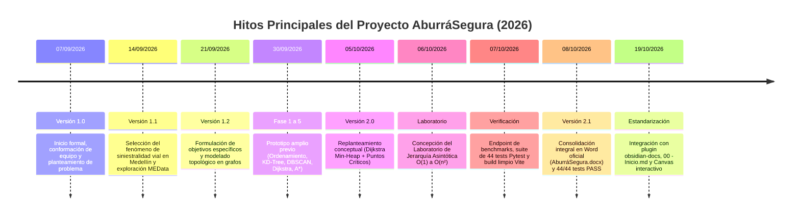

# 📝 Historial de Cambios — Proyecto AburráSegura

> [!abstract] En pocas palabras
> Registro cronológico de hitos, versiones formales del documento institucional (`AburráSegura.docx`), avances algorítmicos y cambios de infraestructura para el PPI de Análisis de Algoritmos.

---

## 📌 Versiones Formales del Documento Institucional (`AburráSegura.docx`)

### [v2.1] — 2026-10-08 (Consolidación Técnica Definitiva)
- **Tabla 1 de Abreviaturas:** 25 siglas técnicas estandarizadas alfabéticamente (API a WGS84).
- **Tabla 2 de Objetivos Específicos:** Alineación formal de fases y entregables del documento.
- **Tablas 4 a 13 (Requisitos y Restricciones):** 16 Requerimientos Funcionales (RF-01 a RF-16) y restricciones normativas (Ley 1581 Habeas Data, ODbL).
- **Tabla 14 (Presupuesto):** Presupuesto referencial de hardware valorado en $3.940.000 COP con equipos locales.
- **Suite de Pruebas Pytest:** Certificación de **44/44 pruebas aprobadas (100% PASS en 8.31s)**.
- **Referencias Bibliográficas:** 11 fuentes académicas depuradas bajo norma APA 7ma edición.

### [v2.0] — 2026-10-05 (Replanteamiento Orientado a Sustentación)
- Definición del enfoque principal: Algoritmo de Dijkstra multiobjetivo con cola de prioridad min-heap $\mathcal{O}((V + E) \log V)$ para evitar puntos críticos viales.
- Redacción formal de Portada, Resumen, Introducción y Sección 1 completa.

### [v1.2] — 2026-09-21 (Formulación de Objetivos y Grafo)
- Especificación de los 3 objetivos específicos del PPI.
- Justificación pedagógica y social para la movilidad segura en Medellín.

### [v1.1] — 2026-09-14 (Exploración de Fuentes)
- Evaluación de dominios de aplicación y selección de la accidentalidad vial de Medellín con datos abiertos de MEData.

### [v1.0] — 2026-09-07 (Inicio del Proyecto)
- Estructuración de plantilla oficial y asignación de roles del equipo (Jarrison Quintero, Sebastián Gómez, Cristian Pulgarín).

---

## 🔗 Relacionado

- [[00 - Inicio|Página de Inicio del Vault]]
- [[MOC-Principal|MOC Principal de AburráSegura]]
- [[Registro-Actualizaciones|Registro Formal de Actualizaciones (Tabla 0 del Word)]]
- [[Matriz-Requisitos|Matriz Integral de Trazabilidad]]
