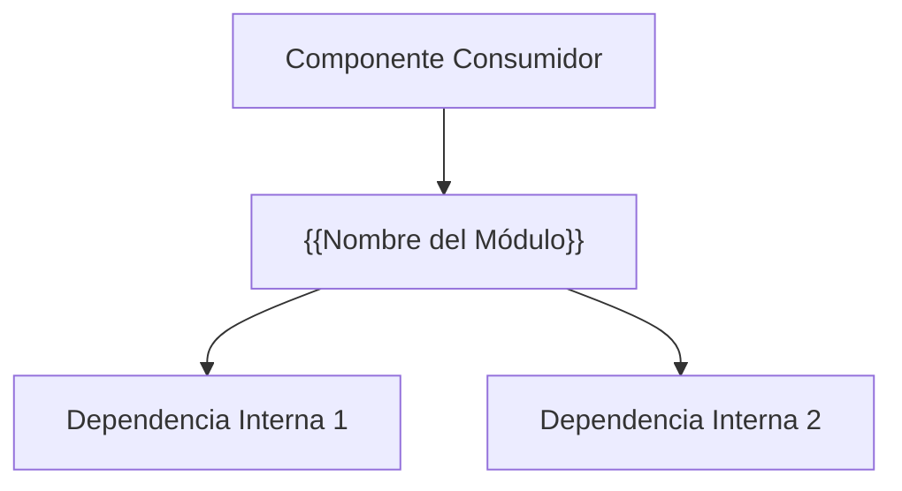

# Módulo: {{Nombre del Módulo}}

> [!abstract] En pocas palabras
> Plantilla estándar para la especificación técnica de módulos de software, dependencias y contratos de interfaz.

> [!NOTE] Descripción Funcional
> {{Resumen del propósito y alcance técnico del módulo dentro de la arquitectura de 3 capas de AburráSegura.}}

---

## 1. Responsabilidades del Módulo
1. {{Responsabilidad principal 1}}
2. {{Responsabilidad principal 2}}
3. {{Responsabilidad principal 3}}

---

## 2. Diagrama de Relaciones y Componentes

---

## 3. Interfaces y Contratos Públicos
- **Funciones / Clases Principales:**
  - `ClasePrincipal.metodo_a(param1: Tipo) -> Retorno`: {{Descripción}}
  - `ClasePrincipal.metodo_b(param2: Tipo) -> Retorno`: {{Descripción}}
- **Endpoints REST Expuestos (si aplica):**
  - `METHOD /api/v1/...`: {{Descripción y formato JSON}}

---

## 4. Dependencias y Tecnologías
- **Librerías / Frameworks:** {{FastAPI, Pydantic, React, Leaflet, SQLite, etc.}}
- **Archivos Fuente:** `app/...` o `frontend/src/...`

---

## 5. Pruebas y Aseguramiento de Calidad
- Suite de pruebas asociada: `tests/test_{{modulo}}.py`
- Trazabilidad documental: `AburráSegura.docx` (Sección 4.2 / 4.3).
- Enlace al Plan de Pruebas: [[Plan-Pruebas-QA]]

---

## 🔗 Relacionado
- [[00 - Inicio|Inicio]]
- [[MOC-Principal]]
- [[Plantilla-QA]]
